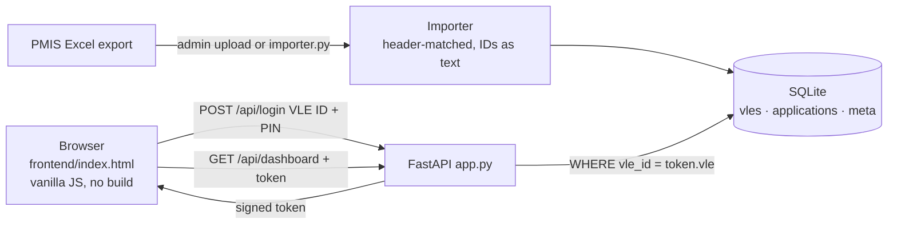

# PMIS – CSC Project · VLE Dashboard

**Update 27-10-2026 (client call):** six agreed stages (Applied → Shortlisted → Selected → Offer Letter Received → Offer Letter Accepted → Joining Verified; old labels "Accepted"→Selected and "Joined"→Joining Verified are mapped automatically). Headline metrics are Joining verified / Selected, not yet joined / Applied to internships. Candidates with several applications are counted once, at their furthest step, with a drop-down showing every application. VLE greeting shows district + state (Excel column `VLE District`). Admin users get a project overview with state and district filters. Logins are set in `data/pins.csv` (`ID,PIN[,admin]`).


Replaces the Excel + Power BI setup. A VLE (the "head") opens the site, types their **VLE ID + 4-digit PIN**, and sees only the interns registered under them, drawn as pictures rather than tables.

## What the VLE sees

| Section | What it shows | Why it's built this way |
|---|---|---|
| Big number + 3 tiles | People under you · Joined work · On the way · Only applied | One number to remember, then three colour-coded groups |
| Figure wall | One person figure per application, coloured by stage | Shows the count and the stage mix without reading anything |
| Joined ring | % of applications that reached "Joined" | The one goal |
| Journey road | 6 stops with icon, step number, colour and count. Tap a stop to filter | Each stage has its own icon and colour, so it can be followed without reading |
| Find a person | Search by **name, Candidate ID or Internship ID** | Lets the VLE look someone up by Candidate ID or Internship ID |
| Person cards | Name, company, 6-segment progress bar, stage badge, both IDs | Shows how far each person has got along the road |
| Person detail | Full vertical journey, "Next: …", all fields (VLE ID, location, CSC project code) | |
| Companies / CSC projects | Stacked stage bars per company; project-code chips. All tap to filter | |
| Languages | English · हिंदी · ಕನ್ನಡ · मराठी (one tap, remembered) | |
| 🔊 Listen | Reads the summary or one person's status aloud in the chosen language | Helps VLEs who read slowly |

**Admin** (`ADMIN` login): sees every VLE as a card, opens any VLE's dashboard, and uploads a new PMIS Excel export from the browser. The upload replaces the old monthly Power BI refresh.

## Architecture



* **Access control (replaces Power BI RLS):** the VLE ID comes from the signed token, never from the request, so a VLE has no way to ask for another VLE's rows. PINs are stored as salted PBKDF2 hashes. After 5 wrong tries the login is locked for 15 minutes.
* **Data model:** each row in `applications` is one application (Candidate × Internship). The `vles` table holds one login per VLE (`role` = `vle` or `admin`).
* **Stage order** is set in one place, `backend/db.py → STAGES`. The frontend uses the same order.

```
pmis-vle-app/
├─ backend/
│  ├─ app.py          API + serves the frontend
│  ├─ db.py           schema, PIN hashing, stage order
│  ├─ importer.py     Excel → SQLite (CLI and upload)
│  └─ requirements.txt
├─ frontend/index.html  whole UI in one file (EN/HI/KN/MR)
├─ scripts/build_demo.py  offline single-file demo with embedded data
├─ data/              SQLite DB + new_vle_pins.csv (keep private)
└─ Dockerfile
```

## Run it

```bash
cd backend
pip install -r requirements.txt
python importer.py ../data/sample_PMIS.xlsx --admin-pin 9999   # creates DB, VLE PINs -> data/new_vle_pins.csv
export PMIS_SECRET="$(python -c 'import secrets;print(secrets.token_hex(32))')"
uvicorn app:app --host 0.0.0.0 --port 8000
```
Open http://localhost:8000. Hand each VLE their PIN from `data/new_vle_pins.csv`, then delete that file.

**Docker:** `docker build -t pmis-vle . && docker run -p 8000:8000 -e PMIS_SECRET=... -v $PWD/data:/app/data pmis-vle`
(Run the importer once inside the container, or log in as ADMIN and upload the Excel file.)

**Production checklist:** serve over HTTPS (nginx/Caddy in front), set a strong `PMIS_SECRET`, back up `data/pmis.db`, and keep `new_vle_pins.csv` off shared drives.

## Open data questions (carried over from the Power BI notes)
1. Is "Accepted" the same as "Offer Letter Accepted"? Both are kept as separate stages for now. If they are the same, merge them in `STAGES`.
2. There are no stage dates, so the app shows where each person is now but not how long they have been there. Adding a date column per stage would enable "stuck for 30+ days" alerts.
3. Sample data: VLE `VLEGU20269` (GU suggests Gujarat) is listed with location Rajasthan. Check this against the source.
